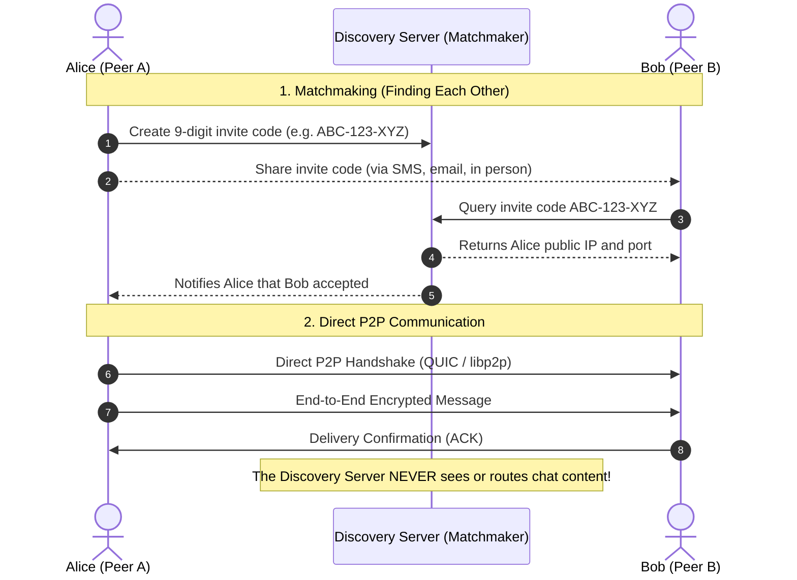

# GoChat

<p align="center">
  
  
  
  
  
  
</p>

```text
                          ______      ________          __ 
                         / ____/___  / ____/ /_  ____ _/ /_
                        / / __/ __ \/ /   / __ \/ __ `/ __/
                       / /_/ / /_/ / /___/ / / / /_/ / /_  
                       \____/\____/\____/_/ /_/\__,_/\__/  
                       
                                 P 2 P   C H A T
                       
                           ⠋  Connecting to P2P network...
                           Peer ID: 12D3KooW...
```

**GoChat** is an ultra-fast, terminal-based peer-to-peer (P2P) messaging application written in Go.

Unlike traditional chat apps (WhatsApp, Telegram, Discord, Slack) where conversations pass through and sit on corporate cloud servers, **in GoChat your messages never pass through any central server**. Every single message, acknowledgment, and status ping travels **directly** from your computer to your peer's computer.

---

## 🎯 The Core Philosophy

Most modern chat platforms operate on client-server architectures:
1. Alice sends a message to Server X.
2. Server X stores the message in a central database.
3. Server X delivers the message to Bob.

If Server X goes down, leaks data, or is monitored, privacy and availability are compromised.

**GoChat eliminates the middleman entirely:**
* **No Middle Server Routing**: Messages fly directly peer-to-peer over encrypted UDP/QUIC streams.
* **No Cloud Chat Logs**: There is no database in the cloud storing your message history.
* **Local-First Privacy**: History is saved exclusively on your local disk in a private, embedded database (`~/.gochat/gochat.db`).

---

## 🔌 How It Works (In a Nutshell)

Connecting two personal computers directly across the internet is challenging because of home routers, Wi-Fi networks, and firewalls (NAT). 

To solve this, GoChat uses a **Discovery Server as a lightweight matchmaker (signaling broker)**. The Discovery Server **only** introduces peers to each other—it **never** touches, reads, or routes message contents.



1. **Cryptographic Identity**: When you first run GoChat, an Ed25519 cryptographic key pair is created locally (`~/.gochat/identity.key`). Your unique **PeerID** is derived directly from this key.
2. **Invite Pairing**: You create an invite code (valid for 10 minutes) and send it to your friend.
3. **P2P Dialing**: Once Discovery exchanges network addresses, your computers establish a direct, encrypted libp2p connection.
4. **Self-Healing IP Resolution**: If a peer switches Wi-Fi networks or gets a new IP, GoChat automatically queries Discovery for their fresh IP, updates the route, and reconnects seamlessly.

---

## ✨ Key Features

* 🔒 **End-to-End Encryption (E2EE)**:
  * **X25519 Key Derivation**: Recipient public keys are derived directly from their PeerID ([RFC 7748](https://datatracker.ietf.org/doc/html/rfc7748)).
  * **XChaCha20-Poly1305 (AEAD)**: Symmetric encryption with 24-byte cryptographically secure nonces and HKDF-SHA256 key derivation.
  * **Ed25519 Digital Signatures**: Every message envelope is digitally signed to prevent spoofing and tampering.
* 🟢 **Real-Time Presence & Status**:
  * Continuous 10-second heartbeat ping.
  * Shows **`● online`** in green or **`○ seen dd/mm hh:mm`** when offline.
* 💬 **WhatsApp-Style Dynamic Ordering**:
  * Your active conversations automatically sort to the top whenever a new message is sent or received.
* 💥 **Cryptographic Erasure (AES-256 Crypto-Shredding)**:
  * Want to wipe all your data completely? Go to Settings (<kbd>Esc</kbd>) $\rightarrow$ *Wipe all messages and contacts*.
  * Overwrites 100% of the database file on disk with random **AES-256 ciphertext** using an ephemeral in-memory key, forces a hardware flush (`Sync`), and deletes the file. Recovery is mathematically impossible.
* 🌐 **Multilingual with Auto-Detection**:
  * Fully translated in **English**, **Português (Brasil)**, and **Español**.
  * Automatically detects your operating system language (Windows API / POSIX variables) with English fallback.
  * Switch languages dynamically in real-time from the Settings menu (<kbd>Esc</kbd>).
* 📦 **Offline Outbox & Reliable Delivery**:
  * If your peer is temporarily offline, messages wait in your local outbox and automatically flush the moment they reconnect.

---

## 📥 Downloads & Installation

Choose the package for your operating system:

| Platform | Architecture | Package Type | Download Link |
| :--- | :--- | :--- | :--- |
| **Windows** | `x86_64 / amd64` | **Graphical Installer (`.exe`)** | [⬇️ Download Windows Installer](https://github.com/JoaoVitor615/gochat/releases/download/v0.6.0/gochat-setup-windows-amd64.exe) |
| **Windows** | `x86_64 / amd64` | Portable (`.zip`) | [⬇️ gochat-v0.6.0-windows-amd64.zip](https://github.com/JoaoVitor615/gochat/releases/download/v0.6.0/gochat-v0.6.0-windows-amd64.zip) |
| **Windows** | `ARM64` | Portable (`.zip`) | [⬇️ gochat-v0.6.0-windows-arm64.zip](https://github.com/JoaoVitor615/gochat/releases/download/v0.6.0/gochat-v0.6.0-windows-arm64.zip) |
| **Linux** | `x86_64 / amd64` | Archive (`.tar.gz`) | [⬇️ gochat-v0.6.0-linux-amd64.tar.gz](https://github.com/JoaoVitor615/gochat/releases/download/v0.6.0/gochat-v0.6.0-linux-amd64.tar.gz) |
| **Linux** | `ARM64` | Archive (`.tar.gz`) | [⬇️ gochat-v0.6.0-linux-arm64.tar.gz](https://github.com/JoaoVitor615/gochat/releases/download/v0.6.0/gochat-v0.6.0-linux-arm64.tar.gz) |
| **macOS** | `Apple Silicon (M1/M2/M3/M4)` | Archive (`.tar.gz`) | [⬇️ gochat-v0.6.0-darwin-arm64.tar.gz](https://github.com/JoaoVitor615/gochat/releases/download/v0.6.0/gochat-v0.6.0-darwin-arm64.tar.gz) |
| **macOS** | `Intel 64-bit` | Archive (`.tar.gz`) | [⬇️ gochat-v0.6.0-darwin-amd64.tar.gz](https://github.com/JoaoVitor615/gochat/releases/download/v0.6.0/gochat-v0.6.0-darwin-amd64.tar.gz) |

### Building from Source

```bash
# Clone the repository
git clone https://github.com/JoaoVitor615/gochat.git
cd gochat

# Build the GoChat client
go build -o gochat ./cmd/gochat

# Run GoChat
./gochat
```

---

## ⌨️ Keyboard Shortcuts (TUI)

| Key | Action |
| :--- | :--- |
| <kbd>↑</kbd> / <kbd>↓</kbd> or <kbd>k</kbd> / <kbd>j</kbd> | Navigate contact list or settings options |
| <kbd>Enter</kbd> | Open active conversation / Send message / Select option |
| <kbd>Esc</kbd> | Back to peer list / Open **Settings** / Close dialog |
| <kbd>i</kbd> | Generate a new invite code |
| <kbd>a</kbd> | Add a contact using an invite code |
| <kbd>Ctrl</kbd> + <kbd>n</kbd> | Set or edit contact nickname |
| <kbd>Ctrl</kbd> + <kbd>l</kbd> | Open / close live System Logs |
| <kbd>Ctrl</kbd> + <kbd>u</kbd> | Clear current chat input line |
| <kbd>q</kbd> | Quit application |

---

## 🛠️ Architecture & Tech Stack

* **Language:** [Go](https://go.dev/) (1.23+)
* **P2P Transport:** [libp2p](https://github.com/libp2p/go-libp2p) with QUIC v1 (`/gochat/2.0.0` and `/gochat/presence/1.0.0`)
* **Cryptography:** Ed25519, X25519 (ECDH), HKDF-SHA256, XChaCha20-Poly1305, AES-256-CTR
* **Terminal UI:** [Bubble Tea](https://github.com/charmbracelet/bubbletea) & [Lipgloss](https://github.com/charmbracelet/lipgloss)
* **Local Storage:** [bbolt](https://github.com/etcd-io/bbolt) (Embedded key-value ACID store)
* **Signaling Service:** Go HTTP API + [Redis](https://redis.io/)

---

## 📄 License

This project is open-source and distributed under the [MIT License](LICENSE).
